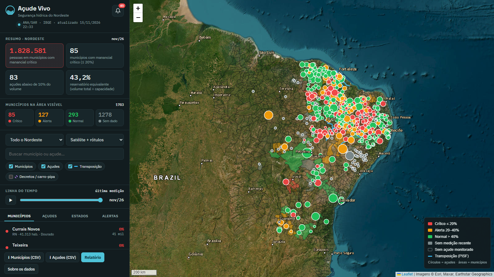
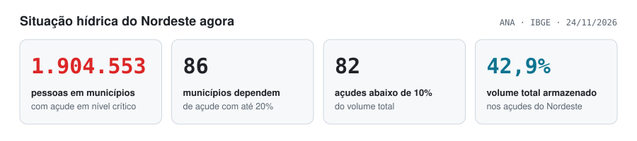
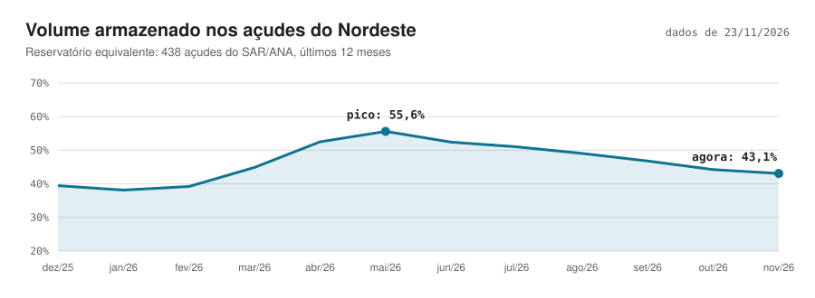
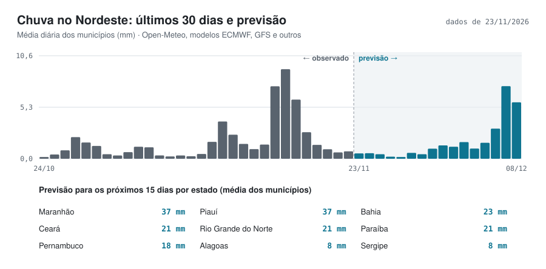
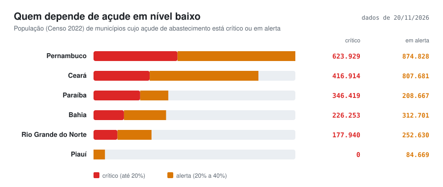
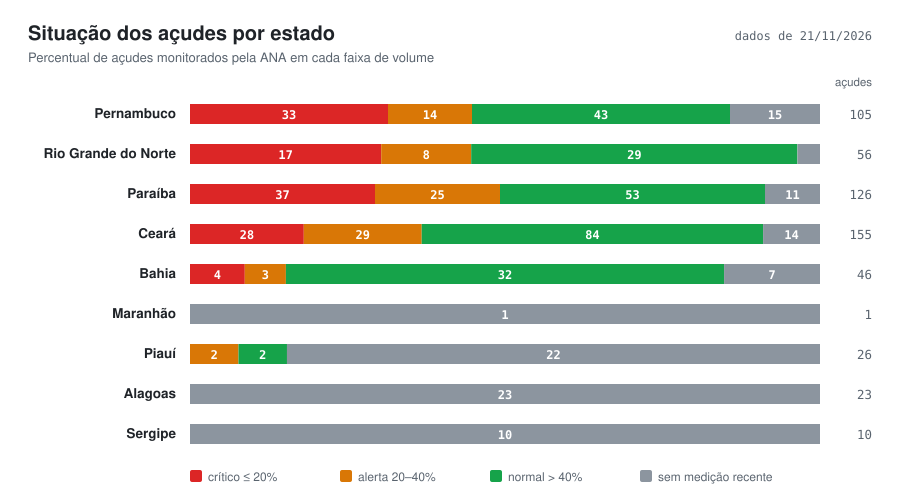
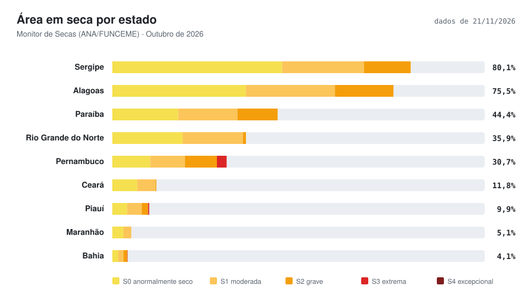
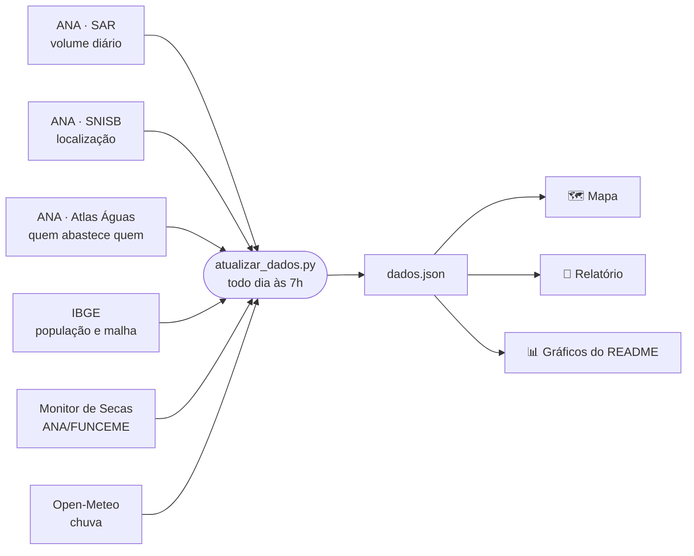

<div align="center">

# 💧 Açude Vivo

### O mapa da água do Nordeste, atualizado todo dia com dados oficiais

**548 açudes · 1.794 municípios · 9 estados · 100% dados públicos**

[](https://github.com/Sergiorsantana/Acude-vivo/actions/workflows/atualizar.yml)
[](https://github.com/Sergiorsantana/Acude-vivo/commits/main/monitor-reservatorios/dados.json)
[](https://sergiorsantana.github.io/Acude-vivo/)
[](https://www.python.org/)
[](#rodar-no-seu-computador)
[](LICENSE)
[](https://github.com/Sergiorsantana/Acude-vivo/stargazers)

### [👉 Abrir o mapa](https://sergiorsantana.github.io/Acude-vivo/)

<a href="https://sergiorsantana.github.io/Acude-vivo/"></a>

</div>

## Por que existe

No semiárido, saber quanto de água sobra em cada açude decide quando mandar carro-pipa, quando decretar emergência e onde investir. Esses dados existem, mas estão espalhados em sistemas diferentes da ANA, do IBGE e da FUNCEME. O Açude Vivo junta tudo em um mapa só e responde a pergunta que importa: **quantas pessoas dependem de um açude que está secando?**

## O Nordeste agora









<details>
<summary><b>Ver mais gráficos: açudes por estado e área em seca</b></summary>
<br>





</details>

<sub>Estes gráficos são gerados automaticamente todo dia a partir dos dados mais recentes.</sub>

## O que o app faz

| | |
|---|---|
| 🗺️ **Mapa de satélite** | Açudes e municípios coloridos por situação: crítico (≤ 20%), alerta (20–40%), normal (> 40%) |
| 👥 **Gente, não só água** | Liga cada município ao açude que o abastece (Atlas Águas/ANA) e soma a população afetada |
| 📉 **Previsão** | Volume em 30, 60 e 90 dias e quantos dias faltam para o açude chegar a 5% no ritmo atual |
| 🔔 **Alertas** | Açudes que caíram abaixo de 20% ou 10% no último mês e cidades com poucos dias de água |
| 🛰️ **Antes e depois** | Compara imagens de satélite de 2014 até hoje para qualquer açude |
| 🌧️ **Chuva e previsão** | Chuva dos últimos 30 dias e previsão dia a dia para os próximos 15 dias em cada um dos 1.794 municípios; o mapa pode ser colorido pela chuva |
| 🏜️ **Monitor de Secas** | Área de cada estado em seca, de "anormalmente seco" (S0) a excepcional (S4) |
| 🚰 **Transposição** | Canais do São Francisco e municípios já beneficiados ou previstos |
| 💬 **Pergunte aos dados** | Assistente que responde em português ("Vai chover em Patos?", "Quantas pessoas estão em risco na Paraíba?") buscando só nos dados oficiais, sempre com a fonte. Não usa IA generativa, então não inventa nada e não custa nada |
| 📄 **Relatório em PDF** | Relatório por estado pronto para anexar em ofício |
| 📊 **Planilhas** | Exporta municípios e açudes em CSV, abrindo direto no Excel |
| ⏳ **Linha do tempo** | Anima os últimos 12 meses para ver a chuva encher e a seca esvaziar |

## Como funciona



Uma tarefa agendada roda o script todo dia às 7h, salva os dados novos, redesenha os gráficos acima e envia ao GitHub, que publica o site. Nenhum servidor, nenhum banco de dados, nenhum custo.

## Fontes

Todos os dados são públicos e gratuitos:

- **ANA**: SAR (volumes), SNISB (barragens) e Atlas Águas (abastecimento e transposição)
- **Monitor de Secas**: ANA, FUNCEME e parceiros estaduais
- **IBGE**: Censo 2022 e malha municipal
- **Open-Meteo**: chuva observada e prevista
- **Esri World Imagery e Wayback**: imagens de satélite

Metodologia, cálculos e limitações estão em [`sobre.html`](https://sergiorsantana.github.io/Acude-vivo/monitor-reservatorios/sobre.html).

## Rodar no seu computador

Precisa só de Python 3.9 ou mais novo. Nenhum pacote para instalar.

```bash
git clone https://github.com/Sergiorsantana/Acude-vivo.git
cd Acude-vivo/monitor-reservatorios
python servidor.py
```

O app abre em http://localhost:8765 e se atualiza a cada 12 horas enquanto estiver aberto. Mais detalhes em [`LEIAME.md`](monitor-reservatorios/LEIAME.md).

## Atualização automática

O site da ANA não responde a servidores fora do Brasil, então a coleta roda num computador no Brasil: o script [`atualizar_e_enviar.ps1`](atualizar_e_enviar.ps1) é executado todo dia pelo Agendador de Tarefas do Windows, baixa os dados, redesenha os gráficos e envia ao GitHub. A cada envio, o workflow [`publicar`](.github/workflows/atualizar.yml) republica o site.

Para rodar na hora: `powershell -ExecutionPolicy Bypass -File .\atualizar_e_enviar.ps1`. Rode `git pull` antes de enviar alterações feitas à mão.

## Contribua

Ideias e correções são bem-vindas. Abra uma [issue](https://github.com/Sergiorsantana/Acude-vivo/issues) se encontrar um açude no lugar errado, um município ligado ao açude errado ou uma fonte de dados que deveria estar aqui.

<div align="center">

**Se este projeto for útil para você, deixe uma ⭐. Isso ajuda mais gente a encontrá-lo.**

</div>
